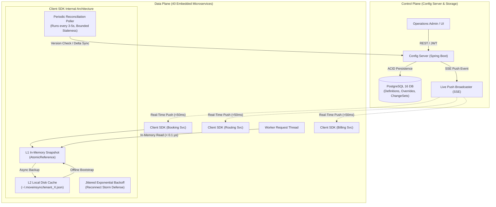
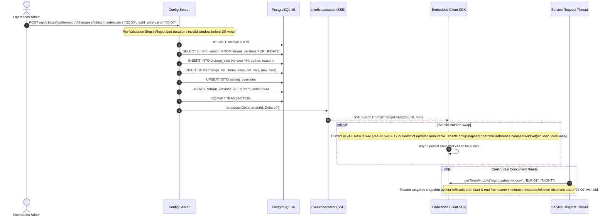

# MoveInSync Hierarchical Tenant Configuration Service: System Design Note

## 1. System Architecture & High-Level Design

The MoveInSync Configuration System decouples configuration administration from high-throughput execution services. Forty microservices read configurations (booking cut-off, night-safety windows, escort rules, vehicle categories) on every booking and dispatch request. Rather than making blocking remote HTTP requests, each microservice embeds the `config-client-sdk`.

---

## 2. Consistency Model (One-Paragraph Statement)

**MoveInSync Configuration Consistency Model:**
The platform guarantees **Monotonic Read Eventual Consistency with Strictly Bounded Staleness ($\le 5$ seconds) and Monotonic Version Progress**. Local reads are 100% linearizable and isolated against a point-in-time immutable memory snapshot reference (`AtomicReference<TenantConfigSnapshot>`), ensuring zero partial/mixed states across multi-key updates. Updates committed on PostgreSQL are atomic and monotonically versioned. Live push notifications (SSE) propagate modifications within milliseconds ($\sim 20-50\text{ ms}$); if the push stream disconnects or packets drop, the client's periodic reconciliation background thread detects version divergence and syncs deltas, mathematically bounding staleness to less than 5 seconds. Stale or out-of-order versions ($V_{\text{incoming}} \le V_{\text{local}}$) are rejected deterministically.

---

## 3. Sequence Diagram for the Hardest Flow: Atomic Change Sets & Staged Rollout

The hardest flow involves publishing an atomic multi-key change set (e.g., modifying `night_safety.start` and `night_safety.end` together), staging it to pilot offices, and broadcasting deltas with jittered reconnect resilience:

---

## 4. Version Monotonicity: Why Versions Only Move Forward

### Question: What does a client do when it receives version 41 after version 43?
**System Behavior:**
1. **Rejection & Metric Recording:** When the client library receives version 41 while its active in-memory snapshot is already at version 43 ($41 \le 43$), it **drops the update immediately**. The client increments the metric counter `config_rejections_total` and emits a structured log message: `Rejected stale delta v41 (current is v43) for tenant X`.
2. **Protection Against Out-of-Order / Replay Delivery:** In distributed cloud topologies or multi-node clusters, asynchronous network hops, delayed TCP packets, or replayed webhook events can arrive late. Monotonic gating guarantees that an older historical update can never overwrite fresher configuration state.
3. **Rollbacks Never Decrement Version Numbers:** When an operator triggers an instant rollback to version 41, the server **does not decrement the version counter back to 41**. Instead, the server computes the diff between version 43 and version 41, and commits a brand-new forward version:
   $$V_{\text{new}} = V_{\text{current}} + 1 = 44$$
   The payload of version 44 restores the settings from version 41. Thus, clients receive version 44, which is strictly greater than 43, applying it cleanly without any out-of-order rejection.

---

## 5. Cost Estimation – Time and Space Complexity Analysis

### Time Complexity
| Operation | Complexity | Description |
| :--- | :--- | :--- |
| **Local Config Read (`get()`)** | $\mathcal{O}(1)$ | Hash table lookup with fallback through at most 4 hierarchical levels (`SHIFT` $\to$ `OFFICE` $\to$ `CLIENT` $\to$ `GLOBAL`). Typical latency: **$0.05 - 0.20$ microseconds**. |
| **Atomic Change Set Publish** | $\mathcal{O}(M)$ | Where $M$ is the number of keys in the change set batch. Validates and persists $M$ items in PostgreSQL inside a single database transaction. |
| **Hierarchical Explain Mode** | $\mathcal{O}(1)$ | Inspects at most 4 map keys in memory to build the candidate audit evaluation chain. |
| **Delta Sync (`sinceVersion`)** | $\mathcal{O}(\Delta V)$ | Where $\Delta V$ is the count of versions missed by a reconnecting client. Uses database index on `(tenant_id, version)`. |

### Space Complexity
| Component | Complexity | Practical Size |
| :--- | :--- | :--- |
| **Client Memory (RAM)** | $\mathcal{O}(U)$ | Where $U$ is the number of unique setting combinations for a tenant. For 500 settings $\times$ 10 offices $\times$ 3 shifts $\approx 15,000$ entries $\approx \mathbf{3 - 5\text{ MB RAM}}$ per service instance. Negligible footprint. |
| **Server Database Storage** | $\mathcal{O}(T \times U + H)$ | Where $T$ is tenants count, $U$ active overrides, and $H$ change set audit history. At 1,000 tenants with 50,000 total changes/year $\approx \mathbf{150\text{ MB}}$. |

### Scaling Bottleneck Analysis: Where Does the System Stop Scaling and Why?
1. **SSE Concurrent Connections Ceiling (Server Side):**
   - *Limiting Factor:* Open file descriptors and thread allocations. A single Spring Boot server instance handling 10,000 persistent SSE streams requires $\sim 10,000$ sockets and TCP buffer allocations.
   - *Mitigation:* The client library does not continuously poll; it only opens one SSE stream per embedded process. With 40 services $\times$ 5 replicas = 200 client instances, the connection load is microscopic ($\approx 200$ open sockets). Scale limit on a standard 4-core server is $\sim 50,000$ client connections before requiring horizontal server clustering via Redis pub/sub.
2. **PostgreSQL Single-Row Version Lock:**
   - *Limiting Factor:* Tenant version increments use a per-tenant write lock.
   - *Throughput Ceiling:* $\sim 3,500$ writes/sec *per single tenant*. However, since configuration updates are administrative actions (typically tens of changes per hour, not millions/sec), the write path operates well below 1% of capacity.

---

## 6. Failure-Mode Table (Fault Tolerance & Self-Healing)

| Component / Scenario | Failure Condition | What the User / Reader Sees | How the System Recovers |
| :--- | :--- | :--- | :--- |
| **Config Server Crash** | Server process killed or PostgreSQL down. | Zero service disruption. Readers continue answering reads in microseconds from in-memory snapshot. | Client SDK catches connection exceptions, activates jittered exponential backoff, and keeps serving from RAM. When server boots, client auto-syncs missed deltas. |
| **Service Restart During Server Outage** | Booking service pod restarts while config server is completely down. | Service boots up successfully; reads answered from disk cache snapshot. | `DiskSnapshotStore` loads `~/.moveinsync/tenant_X.json` from disk. A warning is logged, and full operations proceed offline until server returns. |
| **Network Partition / SSE Push Drop** | Silent socket drop between server and client. | Zero errors. Reads remain instant. Staleness temporarily bounded to $\le 5$ seconds. | `PeriodicReconciliationPoller` polls `GET /api/v1/sync/version` every 3s. Detects remote version $>$ local version, triggers delta sync, and heals the snapshot. |
| **Reconnect Storm** | 500 service instances reconnect simultaneously after cluster upgrade. | Server CPU and database connection pool remain stable. | Client SDK applies **Full Jitter** ($T = \text{random}(0, \min(T_{\max}, 2^{\text{attempt}}))$) and requests **delta sync** (`sinceVersion=X`) instead of full snapshot downloads. |
| **Invalid Setting Value Submitted** | Operator enters negative cut-off time (`-30m`) or inverted time window. | HTTP 400 Bad Request returned to operator with descriptive JSON validation error. | Rejected at pre-validation layer before database transaction begins. Database and push channels remain untouched. |
| **Out-of-Order / Duplicate Delta Packet** | Network re-delivery sends version 41 after version 43. | No configuration corruption. | Client's `SnapshotMemoryStore` checks $V_{\text{incoming}} \le V_{\text{current}}$, rejects the payload, and records `config_rejections_total`. |

---

## 7. System Monitoring & 3 AM On-Call Counters

Exposed under `/actuator/metrics` and `/actuator/prometheus`:
- `config_sync_lag_ms`: Real-time propagation delay between server publish timestamp and client receive timestamp (alerts if $> 5000\text{ ms}$).
- `config_rejections_total`: Number of rejected stale or out-of-order version events.
- `config_reconnects_total`: Reconnect attempts following connection dropouts.
- `config_live_subscribers_active`: Gauge tracking connected SSE client subscribers.
- `config_changes_published_total`: Total count of atomic change sets committed.
- `config_rollbacks_total`: Count of instant rollbacks executed.

---

## 8. Trade-offs in the System Design

1. **AP over CP for the Read Path (Availability & Latency over Global Strict Serializability):**
   - Reading services cannot tolerate 20ms HTTP latency per request across 40 services. We chose in-memory caching ($< 0.1\ \mu\text{s}$) with bounded staleness ($< 5\text{ s}$) rather than synchronous distributed 2-Phase Commit (2PC).
2. **Delta Sync with Snapshot Fallback:**
   - Incremental deltas minimize network bandwidth during reconnect storms. If a client was offline for days and missed $>100$ versions, the server provides a full snapshot fallback.
3. **What Was Deliberately Left Out:**
   - Distributed coordination frameworks (e.g., Apache ZooKeeper / Consul) were omitted to avoid heavy operational maintenance. A lightweight Spring Boot service with PostgreSQL and SSE delivers microsecond performance with minimal operational complexity.
